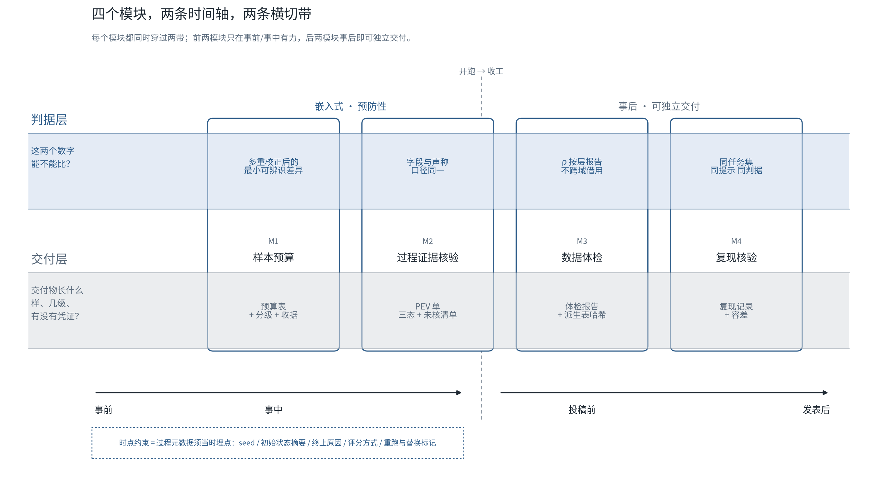

# 四个模块，两条时间轴，两条横切带

对外定位说明。用于向委托方解释这个档案做什么、不做什么、什么时候能做。

定版表述：

> 四个模块，两条时间轴，两条横切带：样本预算、过程证据核验、数据体检、复现核验；左带判据定“这两个数字能不能比”，右带交付定“交付物长什么样、几级、有没有凭证”。每个模块都要同时穿过两带。前两个模块嵌入过程、预防性，后两个模块事后即可独立交付。

## 图怎么读

横轴是时间，但被虚线切成两段：左段“事前 → 事中”是嵌入式区间，右段“投稿前 → 发表后”是事后区间。四个模块按各自能发力的位置落在轴上，不是四道依次排队的手续。

两条横切带压过四个模块：**判据层**在上，**交付层**在下。每个模块的框体都跨过两条色带——图上看得见框里两段不同的底色，就是这个意思：不存在“只给数、不给判据”，也不存在“只出报告、不带凭证”。

## 为什么是模块

四样东西互不依赖：可以只做数据体检，也可以只做复现核验；可以一次委托全做，也可以隔半年分两次做。它们不是流水线，因为绝大多数委托进来时，执行早就结束了。

## 4×2 矩阵

| 模块 | 判据层：这两个数字能不能比 | 交付层：长什么样、几级、有没有凭证 |
|---|---|---|
| **M1 样本预算** | 预算按层报，并给出多重比较校正后的**最小可辨识差异**；跨层引用须写明来源层与不适用理由 | 预算表 + 分级 + 收据（含目标区间宽度、所需次数、模拟假设、种子） |
| **M2 过程证据核验** | 被核字段与声称口径必须同一；换了站点定义、采集者口径或判据，痕迹就不可比 | PEV 单 + 收据（含字段清单、逐项三态结论、未核项清单） |
| **M3 数据体检** | ρ 与零方差比例按层报告，不并层；**他域 ρ 不借用** | 体检报告 + 收据（含派生表哈希、估计量定义、区间方法、设计效应） |
| **M4 复现核验** | 复现须在与声称相同的任务集、提示、判据下进行；改动任一项即降为部分复现 | 复现记录 + 收据（含输入哈希、重算命令、容差、偏差值） |

## 时点约束的本质：埋点，不是动作

前两个模块受时点约束，这句话容易被读成“这些事不能事后补做”。准确的说法只有一句：

> **过程元数据必须当时埋点。当时没记，事后只能做残缺版核验。**

需要埋的最小集合（`eval_log_min`）：

| 字段 | 作用 | 事后能否重建 |
|---|---|---|
| seed | 复现随机性 | 不能 |
| 初始状态摘要 | 证明每次尝试起点一致 | 不能 |
| 终止原因 | 区分成功、失败、中断、超时 | 部分，只能从日志文字推断 |
| 评分方式 | 判定由人、由脚本还是混合 | 不能 |
| 重跑 / 替换标记 | 剔除失败尝试会改变分母 | 不能 |

这五项一旦缺失，事件级一致性就无从核起；能做的只剩“已留存记录的彼此自洽”，也就是残缺版。

所以前两个模块的卖点是**嵌入式、预防性**——在跑之前和跑之中埋点，边际成本几乎为零；后两个模块的卖点是**事后即可独立交付**——不需要原始过程，只要有数据和声称就能开工。时点约束不是限制，是产品分层依据：一类卖“现在做省十倍”，一类卖“随时可做”。

M1 的预算天然是 ex-ante，没有例外：任何在跑完之后补出来的预算表，都只是事后精度评估，不是预算。

## 判据层里最硬的一条：领域迁移

可比性纪律不是抽象原则。有三条能直接判对错的规则：

1. **ρ 不可跨域借用。** 公开公司数据上测得的站点级 ρ 为 0.0827 [0.056, 0.112]，而档案自有桌面分层在 0.48–0.82；若把 0.5 当先验借过去，误差约六倍。同一份数据换个分层，ρ 从 0.4841 跳到 0.8167。所以任何“参考某处 ρ”的预算，必须写明来源层与不适用理由。
2. **跨本体比较先看任务集重叠。** 声称“同一模型跨三个本体都表现良好”，前提是三个本体的任务集有实质重叠；重叠不足时比较不成立，而不是“稍弱”。
3. **同一批对象被多人重复评分时，必须分开两个方差来源。** 评分人之间的一致性（同一批对象、不同评分人）与对象内重复（同一评分人的多次评分）是两个来源。合成一个数，评分人偏差就摊进对象差异里，事后拆不开。报告时先各自给，再决定是否合成。

## 级别

| 级别 | 含义 | 需要的材料 |
|---|---|---|
| L1 | 用公开件即可核验 | 论文、报告、注册页、公开数据集 |
| L2 | 需委托方提供内部文件 | 计划文件、变更记录、分析脚本、表格清单 |
| L3 | 需逐条记录或逐例数据可重算 | 原始记录、逐例数据、可运行的分析程序 |

级别只说明“依据什么核出来的”，不说明结论好坏。同一份档案里可以同时存在 L1 与 L3 的条目。

每份产出都附一张回执（PEV 单或收据），字段固定，可用仓库内的 JSON Schema 直接校验；校验不通过的产出不签发。回执里必须有两样东西：被核那句话的原文出处、以及明确列出“没有核”的部分。

## 不做清单

1. 不设计实验、不选模型、不调参。
2. 不旁站、不进现场、不代做监查。
3. 不给厂商排名，不出优劣结论。
4. 不做法定认证，不出证书，不写“通过”。
5. 不代写论文、不做期刊审稿、不做查重。
6. 不发布原始日志、视频、图像。
7. 不在追溯情形下承诺前两个模块的全效力。
8. 不出监管结论，不称“符合某项法规”。

## 三种入口

| 入口 | 适用情形 | 通常交付 |
|---|---|---|
| 公开数据入口 | 只有对方公开发布的东西 | 数据体检 + 复现核验（L1） |
| 委托入口 | 对方能提供内部文件 | 四模块任选（L1/L2） |
| 事前入口 | 对方尚未开跑 | 样本预算 + 过程证据核验（L1/L2） |

三条入口的差别不在价格，在能拿到什么材料。材料决定级别，级别决定结论能说多硬。

委托与事前入口的材料要求见 `DATA_TERMS.md`：收实体文件，到场即算哈希并写进记录；链接、截图、单独一张汇总表不算输入。没采集的字段在随文件提交的声明里写明，事后不补——补了也分不出是事前记的还是事后填的。

图上没画的，就是这里没承诺的。
